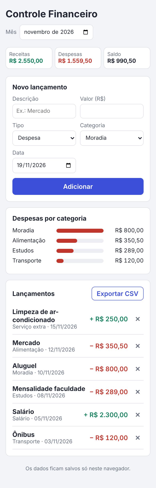

# Controle Financeiro

[](https://github.com/Guindani95/controle-financeiro/actions)

App web para controlar receitas e despesas do mês. Mostra o saldo, os gastos por categoria e exporta os lançamentos para planilha. Funciona no celular, e os dados ficam salvos no próprio navegador.

**▶ [Abrir o app](https://Guindani95.github.io/controle-financeiro/)**



## Funcionalidades

- Cadastro de receitas e despesas com categoria e data
- Resumo do mês: receitas, despesas e saldo (fica vermelho se negativo)
- Gráfico de barras com as despesas por categoria
- Filtro por mês
- Exclusão de lançamentos
- Exportação para CSV (abre no Excel e no Google Planilhas)
- Dados salvos com `localStorage`, então não precisa de servidor nem de cadastro

## Tecnologias

- HTML, CSS e JavaScript puro
- `localStorage` para guardar os dados
- Testes automatizados com `node:test`
- GitHub Actions + GitHub Pages

## Conceitos praticados

- Separar as **regras de negócio** ([`financas.js`](financas.js)) da **interface** ([`app.js`](app.js))
- Validação de dados antes de salvar
- Manipulação do DOM sem framework
- Uso de `textContent` em vez de `innerHTML` para os textos digitados pelo usuário (evita injeção de HTML)
- Datas no fuso local (o `toISOString()` usa UTC e mostraria o dia seguinte depois das 21h no Brasil)

## Rodando os testes

```bash
node --test
```
